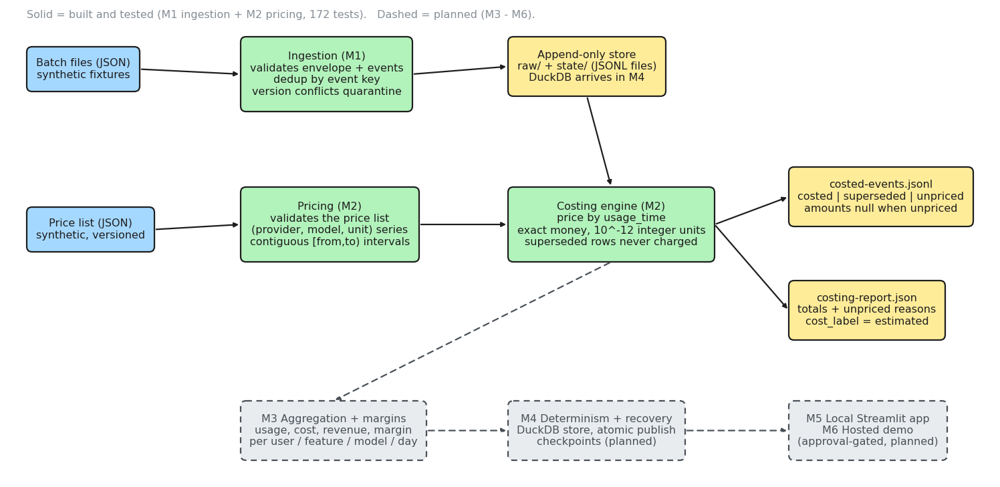
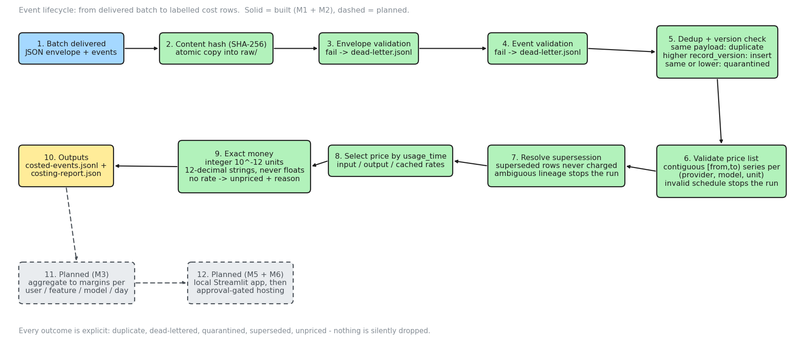

# AI Cost & Margin Pipeline

A local, deterministic data pipeline working toward one question per customer:
*what did this usage cost to serve, what did the customer pay, and is the price
sustainable?*

Today it builds the first part of that answer: raw AI usage events are
validated, deduplicated and costed against a versioned synthetic price list,
producing auditable, money-exact cost rows. The aggregation, revenue and margin
layers that answer the rest of the question are designed but not built yet
(M3 onward). Everything runs on synthetic fixtures; no real customer data has
ever been ingested.

**Status:** milestones M1 (ingestion) and M2 (pricing and costing) are built
and tested. Aggregation and margins (M3) are next. The local app (M5) and the
hosted demo (M6) are planned and approval-gated.

The target is a **production-oriented demo**, not a production-validated
system: there is no multi-user access control, no security review, no SLA and
no real multi-tenant deployment. Any later reliability or reproducibility
claim will be tied to a proof run that demonstrates it.

## Why this exists

An AI product that cannot say which users, features and models drive its cost
cannot price itself. This pipeline builds the trustworthy cost side of that
equation first: every event is validated, deduplicated and costed against a
versioned price list, with explicit outcomes instead of silent drops. Revenue
and margin layers sit on top of that foundation (M3), labelled so it is always
clear where a number came from.

## Milestones

| Milestone | Scope                                                                | State                    |
| --------- | -------------------------------------------------------------------- | ------------------------ |
| M1        | Ingestion foundation: validation, dedup, quarantine, append-only store | Built and tested       |
| M2        | Pricing: exact money, price series and intervals, costing engine     | Built and tested         |
| M3        | Aggregation and margins per user, feature, model, day                | Next (design open)       |
| M4        | Determinism and recovery: DuckDB store, atomic publish, checkpoints  | Planned                  |
| M5        | Local Streamlit app                                                  | Planned                  |
| M6        | Hosted demo deployment                                               | Planned, approval-gated  |
| M7, M8    | Optional extensions                                                  | Optional                 |

## Architecture



Editable source: [docs/diagrams/architecture.excalidraw](docs/diagrams/architecture.excalidraw)
(open at [excalidraw.com](https://excalidraw.com)).

- **Ingestion (M1).** Each delivered batch is hashed (SHA-256) and copied
  atomically into `raw/`, then validated at two levels: the batch envelope and
  every event it carries. Events are deduplicated on their
  `(provider, account, provider_event_id)` key: an identical payload is a
  duplicate and is skipped; a changed payload is accepted only with a strictly
  higher `record_version`, otherwise it is quarantined.
- **Append-only store.** Validated events land in `var/state/events.jsonl`
  alongside a manifest, a dead-letter file, a quarantine file and a per-run
  ingestion report. `var/` is private and gitignored. The store is plain JSONL
  today; DuckDB arrives in M4.
- **Pricing (M2).** The price list is validated before any event is costed:
  one series per `(provider, model, unit)` - unit is input, output or cached -
  built from half-open `[from,to)` intervals that must be contiguous and
  non-overlapping, with an open-ended interval allowed only as the last in a
  series. Duplicate price version ids or duplicate interval starts are
  rejected, the list carries a single currency, and its label must be
  `synthetic`. An invalid schedule is fatal: costing never starts.
- **Costing engine (M2).** Each event is priced by its `usage_time` against
  the matching interval of its `(provider, model)` series. Supersession is
  resolved by `record_version` and by `supersedes` references: superseded
  records are never charged, and ambiguous lineage stops the run instead of
  guessing. Costs are computed in exact integer arithmetic.
- **Outputs.** A fresh output directory per run: `costed-events.jsonl` (each
  row labelled costed, superseded or unpriced; amounts are null when
  unpriced) and `costing-report.json` (counts, totals, unpriced reasons,
  `cost_label: "estimated"`, `price_list_label: "synthetic"`).

## Workflow



Editable source: [docs/diagrams/workflow.excalidraw](docs/diagrams/workflow.excalidraw).

1. A batch arrives as one JSON file: an envelope plus its events.
2. The batch content is hashed (SHA-256) and copied atomically into `raw/`.
3. The envelope is validated; failures go to `dead-letter.jsonl`.
4. Each event is validated; failures go to `dead-letter.jsonl` with the event
   index and reason.
5. Events are deduplicated and version-checked on their event key: an
   identical payload is a duplicate; a changed payload with a strictly higher
   `record_version` is inserted; the same or a lower version is quarantined.
6. The price list is validated: contiguous, non-overlapping `[from,to)`
   series per `(provider, model, unit)`. An invalid schedule stops the run
   before any event is read.
7. Supersession is resolved: records replaced by a higher `record_version` or
   named in another record's `supersedes` are marked superseded and never
   charged; ambiguous lineage stops the run.
8. Each remaining event is priced by its `usage_time`, with separate rates
   for input, output and cached tokens.
9. Cost is computed exactly as integer 10^-12 currency units, serialized with
   twelve decimal places, never floats. An event with no applicable rate (or
   unusable token counts) is unpriced with a named reason.
10. Outputs are written to a fresh directory: `costed-events.jsonl` and
    `costing-report.json`.
11. (Planned, M3) Costed rows aggregate to usage, cost, revenue and margin
    per user, feature, model and day.
12. (Planned, M5 + M6) A local Streamlit app, then an approval-gated hosted
    demo.

Every outcome is explicit: duplicate, dead-lettered, quarantined, superseded,
unpriced - nothing is silently dropped.

## Money and labelling rules

- Money is exact: amounts are integer counts of 10^-12 currency units,
  serialized as strings with exactly twelve decimal places. Floats are
  rejected by construction.
- Rates are six-decimal strings (for example `"0.750000"` per 1,000,000
  tokens) converted to integer micro numerators, so no decimal rounding
  context is ever involved in a price.
- Cached tokens are treated as a subset of input tokens billed at the cached
  rate - a synthetic assumption (S1), not a claim about any real provider.
  A cached count above the input count makes the event unpriced.
- Labels in outputs today: costed rows and reports carry
  `cost_label: "estimated"`; the price list and its selection carry
  `label: "synthetic"` / `price_list_label: "synthetic"`. Costs are estimates
  from a synthetic price list, never billed amounts. Planned revenue and
  margin layers follow the same discipline: simulated revenue will be
  labelled simulated.
- Usage data is synthetic by default. This repository contains no real
  customer data, no real prompts and no real revenue.
- `var/` - the raw event store, run history, manifests and working files -
  stays private and gitignored. Only reviewed, sanitized exports are
  committed.
- No secrets in the repo: no `.env` file, no API keys, no private account
  identifiers. Provider and model names in the fixtures are openly synthetic
  (`synthetic-token-provider`, `synth-small`, `synth-large`).

## Determinism and testing

172 tests under pytest. Ingestion reads no wall clock: `arrival_time` comes
from the batch envelope and the ingest id is content-addressed. Golden
fixtures pin the behavior the suite covers: the Phase 1 fixture generator
reproduces the committed batches byte for byte, and the golden ingestion and
golden costing checks reproduce their frozen expected outputs byte for byte.

## Honest limitations

- Synthetic fixtures only; no real provider data has ever been ingested.
- The store is plain JSONL files; a torn line is a hard stop. DuckDB, atomic
  publish and crash recovery arrive in M4.
- No aggregation, margins or revenue yet (M3), no app (M5), no hosted
  deployment (M6).
- No CI, and no license file yet.

## Stack

Python 3.13, DuckDB (from M4), Streamlit (from M5), plain JSON inputs.
Development happens on Windows; the commands below are PowerShell.

| Direct dependency | Pin      | Why it is pinned                                                      |
| ----------------- | -------- | --------------------------------------------------------------------- |
| `streamlit`       | 1.67.0   | Hosting can auto-upgrade unpinned apps; the pin keeps the demo reproducible |
| `duckdb`          | 2.0.0    | Single-writer analytical store for the local pipeline                 |
| `pytest`          | 9.2.0    | Test runner                                                           |

`requirements.txt` pins the three direct dependencies only; pip resolves
their transitive dependencies at install time.

## Running it

From a fresh clone, in PowerShell at the repo root:

```powershell
py -3.13 -m venv .venv
.venv\Scripts\python.exe -m pip install --only-binary :all: -r requirements.txt
.venv\Scripts\python.exe -m pytest
```

Notes:

- Call `.venv\Scripts\python.exe` directly instead of running `Activate.ps1`,
  so the PowerShell Execution Policy cannot get in the way.
- Do not run `pip install --upgrade pip`: the bundled pip is enough, and
  upgrading would install an unpinned package.
- `--only-binary :all:` fails fast when a wheel is missing instead of
  building from source.

The package uses a `src/` layout, so module commands need `src` on
`PYTHONPATH` (`pytest.ini` sets that for pytest only). A full demo run, using
only the gitignored `var\` directory for generated files:

```powershell
$env:PYTHONPATH = "$PWD\src"

# generate a fresh copy of the synthetic Phase 1 batches into gitignored var\
.venv\Scripts\python.exe -m ai_cost_margin.fixtures --out var\demo-fixtures

# ingest them into the private store
.venv\Scripts\python.exe -m ai_cost_margin.ingest --home var --dir var\demo-fixtures

# cost the ingested events against the synthetic Phase 2 price list
.venv\Scripts\python.exe -m ai_cost_margin.costing --home var --prices fixtures\phase2\price-list-synthetic-v1.json --out var\costing-run-1

# the suite, including the golden ingestion and golden costing checks
.venv\Scripts\python.exe -m pytest
```

`--dir` is non-recursive: only top-level `*.json` files are delivered, so the
generated `expected\` subfolder is never ingested. Costing `--out` must be a
fresh directory that does not exist yet, so runs never overwrite earlier
outputs.

## Repository layout

```text
ai-cost-margin-pipeline/
  docs/                 brief, roadmap, phase contracts, diagrams
  fixtures/phase1/      synthetic ingestion batches and frozen expected outputs
  fixtures/phase2/      synthetic price list, invalid cases, expected outputs
  src/ai_cost_margin/   shared pipeline package
  tests/                pytest suite
  var/                  private working state, gitignored
  build.md              append-only record of progress and evidence
```

## Documentation

- [Project brief](docs/ai-cost-margin-pipeline-brief.md)
- [Implementation roadmap](docs/ai-unit-economics-implementation-roadmap.md)
- [Phase 1 ingestion contract](docs/phase-1-ingestion-contract.md)
- [Phase 2 pricing contract](docs/phase-2-pricing-contract.md)
- [Build log](build.md)
