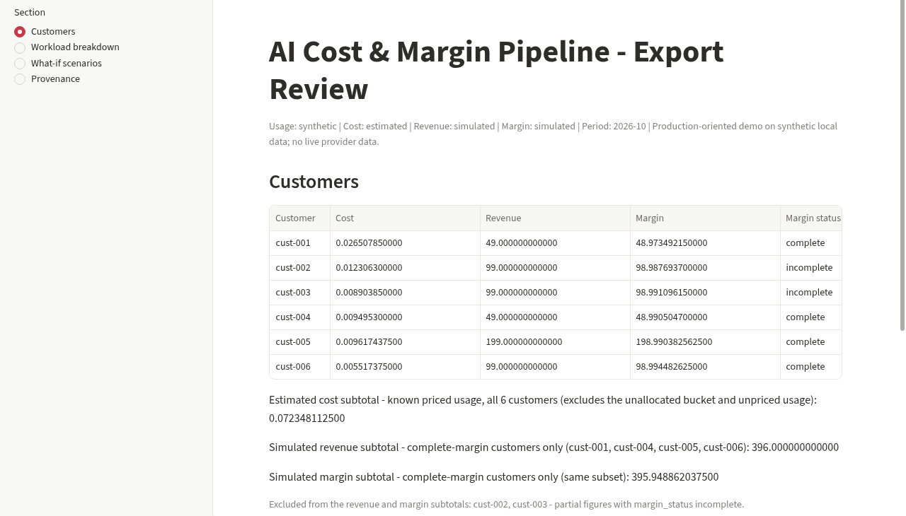
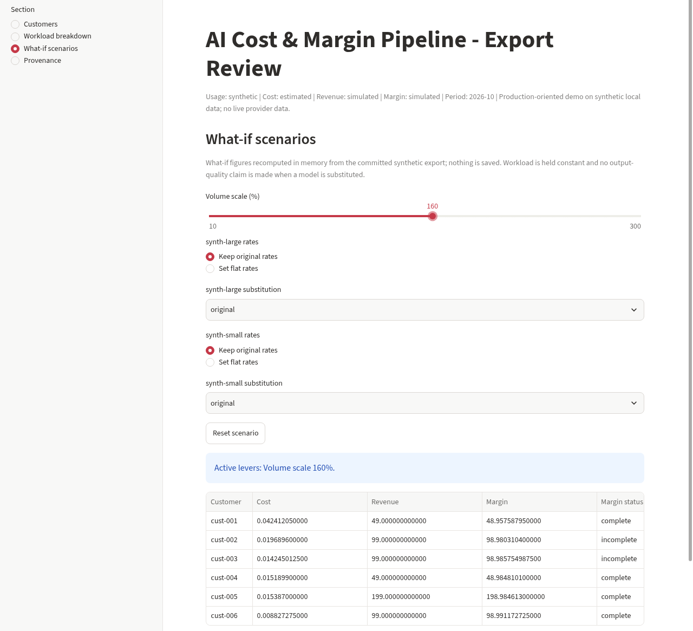
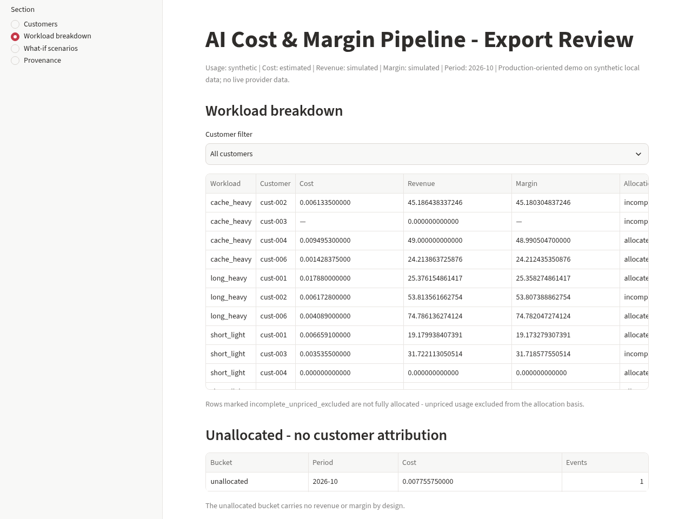

# AI Cost & Margin Pipeline

A local, deterministic data pipeline working toward one question per customer:
*what did this usage cost to serve, what did the customer pay, and is the price
sustainable?*

Raw AI usage events are validated, deduplicated and costed against a versioned
synthetic price list, then aggregated into per-customer and per-workload-type
simulated revenue and margin tables. A Streamlit app shows a sanitized export of
those tables. Every stage is auditable and money-exact. Everything runs on
synthetic fixtures; no real customer data has ever been ingested.

**Status:** milestones M1 (ingestion), M2 (pricing and costing), M3
(aggregation and simulated margins), M4 (determinism and recovery) and M5
(the local app) are built and tested. M6 is built: the hosted demo is live at
https://ai-cost-margin-pipeline.streamlit.app/ (Streamlit Community Cloud, free
tier). Optional extensions (M7, M8) are not built.

The target is a **production-oriented demo**, not a production-validated
system: there is no multi-user access control, no security review, no SLA and
no real multi-tenant deployment. Any later reliability or reproducibility
claim will be tied to a proof run that demonstrates it.

## Demo

Live demo: https://ai-cost-margin-pipeline.streamlit.app/ (synthetic data only;
reporting period 2026-10). The screenshots below are from the hosted app.



*Customers: cost, revenue and margin per customer, with incomplete margins marked.*



*What-if scenarios, with Volume scale set to 160%: costs are recomputed in memory; revenue stays fixed.*



*Workload breakdown: where the cost comes from, including usage that has no customer.*

## Sample output (synthetic data)

One input event from `fixtures/phase1/batch-001-clean.json` (selected fields):

```json
{"provider_event_id": "evt-001-001", "customer_id": "cust-001", "model": "synth-small", "workload_type": "short_light", "usage_time": "2026-10-01T08:00:00Z", "tokens_input": 4825, "tokens_output": 1403, "tokens_cached": 194}
```

Its costed result from `fixtures/phase2/expected/costed-events.jsonl` (selected fields):

```json
{"provider_event_id": "evt-001-001", "cost_status": "costed", "cost_label": "estimated", "price_version_input": "synthetic-prices-v1/synth-small/2026-10-01", "total_cost": "0.006659100000"}
```

A customer margin row from `app/export/customer-margins.jsonl` (selected fields):

```json
{"customer_id": "cust-001", "period": "2026-10", "plan_id": "starter", "simulated_revenue": "49.000000000000", "estimated_cost": "0.026507850000", "simulated_margin": "48.973492150000", "margin_status": "complete", "events_costed": 4, "revenue_label": "simulated", "cost_label": "estimated"}
```

The margin row aggregates every current event for that customer and period
(`events_costed` shows the count); the single event above does not produce it.
See [the margin contract](docs/phase-3-margin-contract.md). All values are
copied from committed files.

## How it works


Editable source: [docs/diagrams/architecture.excalidraw](docs/diagrams/architecture.excalidraw)
(open at [excalidraw.com](https://excalidraw.com)).

- **Ingest (M1).** Batches are hashed, copied into `raw/`, validated and
  deduplicated by event key and `record_version`. Failures go to a dead-letter
  or quarantine file, never silently dropped.
  See [the ingestion contract](docs/phase-1-ingestion-contract.md).
- **Price and cost (M2).** The price list is validated first, then each event is
  priced by `usage_time` in exact integer arithmetic; events that cannot be
  priced are marked unpriced with a reason.
  See [the pricing contract](docs/phase-2-pricing-contract.md).
- **Aggregate (M3).** Costed rows are summed per customer-month and per workload
  type; simulated flat plan revenue is allocated by token volume, and usage with
  no customer stays in an unallocated bucket.
  See [the margin contract](docs/phase-3-margin-contract.md).
- **Run and recover (M4).** One command (`python -m ai_cost_margin.pipeline`)
  runs every stage against a private DuckDB store with atomic checkpoints. An
  interrupted run resumes and reaches byte-identical results.
  See [the determinism contract](docs/phase-4-determinism-contract.md).
- **Export and app (M5, M6).** `python -m ai_cost_margin.export` turns one
  verified run into eight sanitized files under `app/export/`. The Streamlit app
  reads them read-only and verifies them on load. It has four pages: customers,
  workload breakdown, what-if scenarios (recomputed in memory with the pipeline's
  own pricing and aggregation code) and provenance. The hosted demo serves the
  same committed export.


Editable source: [docs/diagrams/workflow.excalidraw](docs/diagrams/workflow.excalidraw).
Every outcome is explicit (duplicate, dead-lettered, quarantined, superseded,
unpriced). The step-by-step rules are in the phase contracts linked under
[Documentation](#documentation).

## Money and labelling rules

- Money is exact: integer counts of 10^-12 currency units, serialized as strings
  with twelve decimal places. Floats are rejected by construction.
- Cached tokens are a subset of input tokens billed at the cached rate - a
  synthetic assumption, not a claim about any real provider.
- Costs are labelled `estimated` and come from a `synthetic` price list, never
  billed amounts. Revenue and margin are labelled `simulated`; usage is
  `synthetic`.
- The repository contains no real customer data, prompts, revenue or secrets.
  `var/` (raw store, run history, working files) is private and gitignored; only
  reviewed, sanitized exports are committed.

## Determinism and testing

On the author's Windows machine, 332 tests are collected under pytest (331
passed, 1 skipped - the explicit golden-generation check). They cover the
scenario engine against hand-calculated values, the app pages through Streamlit
AppTest, and the refusal of a tampered export. A three-point kill drill
(`tools/kill_drill.py`) kills runs at three stages; each resumes to
byte-identical results. Golden fixtures pin the ingestion, costing and margin
outputs byte for byte.

CI: one GitHub Actions workflow (`.github/workflows/ci.yml`) runs the test suite
on Windows with Python 3.13; its first run, on commit 2a22410, completed
successfully. Other platforms are not covered by CI.

## Honest limitations

- Synthetic fixtures only; no real provider data has ever been ingested.
- The single-writer guarantee is cross-process, enforced by the operating
  system file lock DuckDB takes on open; two runner invocations inside one
  process are not serialized by it, so the supported usage is one pipeline
  runner invocation per OS process. The Phase 1-3 JSONL store is unchanged; a
  torn line there is still a hard stop.
- M3 revenue comes from synthetic flat monthly plans, not real contracts; it
  has no proration, discounts, taxes or credits.
- The hosted demo runs on the Streamlit Community Cloud free tier over the same
  committed export. It is a read-only public demo, not a production service,
  and its availability is whatever the free tier provides.
- No license file yet.

## Stack

Python 3.13, DuckDB 2.0.0, Streamlit 1.67.0, pytest 9.2.0 (the three direct
dependencies are pinned in `requirements.txt`; pip resolves the rest).
Development happens on Windows; the commands below are PowerShell.

## Running it

From a fresh clone, in PowerShell at the repo root:

```powershell
py -3.13 -m venv .venv
.venv\Scripts\python.exe -m pip install --only-binary :all: -r requirements.txt
.venv\Scripts\python.exe -m pytest
```

Notes: call `.venv\Scripts\python.exe` directly so the PowerShell Execution
Policy cannot get in the way; do not run `pip install --upgrade pip` (it would
install an unpinned package); `--only-binary :all:` fails fast when a wheel is
missing instead of building from source.

The package uses a `src/` layout, so module commands need `src` on
`PYTHONPATH` (`pytest.ini` sets that for pytest only). A full demo run, using
only the gitignored `var\` directory for generated files:

```powershell
$env:PYTHONPATH = "$PWD\src"

# generate a fresh copy of the synthetic Phase 1 batches into gitignored var\
.venv\Scripts\python.exe -m ai_cost_margin.fixtures --out var\demo-fixtures

# ingest them into the private store
.venv\Scripts\python.exe -m ai_cost_margin.ingest --home var --dir var\demo-fixtures

# cost the ingested events against the synthetic Phase 2 price list
.venv\Scripts\python.exe -m ai_cost_margin.costing --home var --prices fixtures\phase2\price-list-synthetic-v1.json --out var\costing-run-1

# the suite, including the golden ingestion and golden costing checks
.venv\Scripts\python.exe -m pytest
```

`--dir` is non-recursive: only top-level `*.json` files are delivered, so the
generated `expected\` subfolder is never ingested. Costing `--out` must be a
fresh directory that does not exist yet, so runs never overwrite earlier
outputs.

The local app serves the reviewed export committed under `app\export\`, so no
pipeline run is needed first. From the repo root, after the install step above:

```powershell
.venv\Scripts\python.exe -m streamlit run app\streamlit_app.py
```

Open the local URL that Streamlit prints. The app adds `src` to its own import
path, so `PYTHONPATH` is not needed for it. The hosted demo serves the same
export: https://ai-cost-margin-pipeline.streamlit.app/

## Repository layout

```text
.github/              GitHub Actions workflow (CI)
docs/                 brief, roadmap, phase contracts, diagrams, screenshots
fixtures/             synthetic batches, price list, plans and frozen outputs
app/                  Streamlit app, scenario engine, verified export loader
app/export/           committed sanitized export the app serves (8 files)
src/ai_cost_margin/   shared pipeline package
tests/                pytest suite
tools/                hand-calculation checks and the kill drill
var/                  private working state, gitignored
build.md              append-only record of progress and evidence
```

## Documentation

- [Project brief](docs/ai-cost-margin-pipeline-brief.md)
- [Implementation roadmap](docs/ai-unit-economics-implementation-roadmap.md)
- [Phase 1 ingestion contract](docs/phase-1-ingestion-contract.md)
- [Phase 2 pricing contract](docs/phase-2-pricing-contract.md)
- [Phase 3 margin contract](docs/phase-3-margin-contract.md)
- [Phase 4 determinism and recovery contract](docs/phase-4-determinism-contract.md)
- [Build log](build.md)
